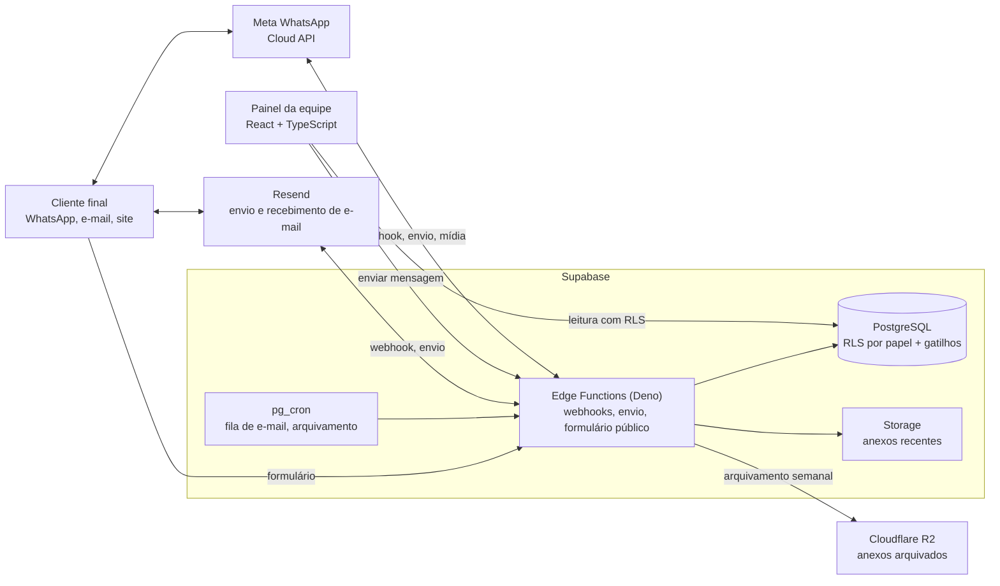

# BTC Atendimento · Atendimento omnichannel por WhatsApp, e-mail e site, em produção

O Biz Talk Center (BTC Atendimento) é o painel em que a equipe de aluguel da Êxito Netimóveis atende clientes por WhatsApp, e-mail e formulário do site. Cada pedido vira um atendimento com protocolo, que passa entre departamentos até ser resolvido. Atuo como desenvolvedor full stack freelancer, contratado diretamente pela Êxito, e respondo pela camada que sustenta o painel: modelo de dados, regras de acesso, funções de servidor, integrações com WhatsApp e e-mail, testes e as telas ligadas a cada entrega, com o sistema em produção e a equipe atendendo.

> Este repositório é um estudo de caso, não um repositório de código. O código-fonte pertence ao cliente e continua privado. Tudo o que está aqui descreve o meu próprio trabalho, em um nível de detalhe que posso aprofundar em entrevista. Nenhum dado de cliente final, membro da equipe ou atendimento real aparece neste estudo de caso.

---

## Visão geral

| | |
|---|---|
| **Meu papel** | Desenvolvedor full stack freelancer: banco de dados e regras de acesso, funções de servidor, integrações com WhatsApp e e-mail, armazenamento, testes e as telas ligadas a cada entrega |
| **Período** | Abril a novembro de 2026 (em andamento) |
| **Status** | Ativo: em produção, com manutenção contínua e entregas validadas pelo QA do cliente |
| **Stack** | React 18, TypeScript, Vite, Tailwind CSS, shadcn/ui, TanStack Query, Supabase (PostgreSQL, Row Level Security (RLS), Edge Functions em Deno, Storage, Auth, pg_cron), Meta WhatsApp Cloud API, Resend, Cloudflare R2, Vitest, Testing Library, Docker (PostgreSQL descartável para testes de banco), Lovable (front-end editado pelo cliente) |
| **Código** | 27 migrations SQL · 3 suítes de teste de banco e 3 verificações de permissão repetíveis · mais de 300 casos de teste automatizados |

## O problema

A equipe de aluguel recebe pedidos por três canais: WhatsApp, e-mail e um formulário no site. Um mesmo pedido costuma passar por mais de um departamento (contratos, manutenção, financeiro, jurídico, entre outros), e o cliente precisa saber com quem está falando, enquanto a equipe precisa ver o histórico inteiro sem perder nenhuma mensagem.

O painel já existia quando cheguei. A equipe do cliente gerou o front-end no Lovable e continua editando as telas por lá, o que dá agilidade para ajustar a interface no dia a dia. A camada que sustenta essas telas ficou comigo: o modelo de dados por trás dos atendimentos, as regras de acesso por papel, as integrações com os canais, as regras do WhatsApp Business, os testes e o diagnóstico e a correção do que aparece em produção quando várias partes do sistema passam a interagir.

Na prática, o trabalho tinha três frentes:

- **Implementação:** funcionalidades novas, como resposta do cliente por e-mail entrando no chat, mídias do WhatsApp, reengajamento fora da janela de 24 horas e anexos no formulário público.
- **Manutenção:** evolução do modelo de atendimento e das integrações sem parar a operação.
- **Correção:** diagnóstico de relatos do QA do cliente até a causa real, com correção testada e verificada em produção.

## Restrições

- **Dois autores no mesmo repositório.** O Lovable faz commits no mesmo repositório que eu, a partir das edições de tela da equipe do cliente. Cada entrega minha precisava conviver com as edições de tela feitas em paralelo pelo cliente, e as telas vão ao ar quando o cliente publica o painel.
- **Produção com atendimento real.** Mudanças de banco entram sem janela de manutenção, e correções de dados em produção são feitas com cópia de segurança e conferência antes e depois.
- **Regras do WhatsApp Business.** A empresa só pode mandar texto livre até 24 horas depois da última mensagem do cliente. Fora disso, só um modelo de mensagem aprovado pela Meta.
- **Limites do plano do Supabase.** Cota de armazenamento por organização, compartilhada com o AvaliaDF (outro produto da Êxito), e limite de processamento por requisição nas funções de servidor.
- **Número de WhatsApp compartilhado.** O mesmo número atende o AvaliaDF, então o webhook precisa reconhecer e ignorar mensagens que pertencem a esse outro fluxo.

## O que construí

**Base segura e canal de WhatsApp (abril de 2026)**
- Revisão de segurança do backend: RLS ativa em todas as 27 tabelas, funções auxiliares fora da API pública e alertas do verificador de segurança do Supabase reduzidos de 19 para 4, com os restantes justificados.
- Webhook do WhatsApp sobre a API oficial da Meta, com verificação de assinatura, menu de departamentos para quem escreve pela primeira vez e criação automática do atendimento no departamento escolhido.

**Modelo de atendimento**
- Atendimento único por cliente, com uma conversa por departamento dentro dele (sub-threads), identificação do cliente por telefone ou e-mail e unificação de cadastros duplicados em produção ([ADR 0001](docs/adr/0001-atendimento-unico-por-cliente-com-sub-threads-por-departamento.md)).
- Gatilho no banco que mantém a conversa do departamento sempre alinhada com o departamento do atendimento, em qualquer caminho de transferência ([ADR 0002](docs/adr/0002-sincronizar-sub-thread-por-gatilho-no-banco.md)).

**Canais**
- Webhook do WhatsApp com roteamento para a conversa do departamento atual, mensagens automáticas (menu de departamentos, confirmação de fila, aviso de retorno com protocolo) e entrada de fotos, vídeos, áudios e documentos no chat.
- Reengajamento fora da janela de 24 horas com modelo de mensagem por setor, e a mensagem do atendente segurada e reenviada quando o cliente reabre a conversa ([ADR 0003](docs/adr/0003-segurar-mensagem-fora-da-janela-de-24-horas.md)).
- E-mail de duas mãos: a resposta do cliente entra no chat do atendimento, as mensagens do mesmo atendimento ficam na mesma conversa na caixa do cliente e o painel mostra o status de entrega de cada e-mail.
- Formulário público com anexo de foto, vídeo, áudio ou documento de até 10 MB e prévia antes do envio.

**Armazenamento e operação**
- Arquivamento semanal de anexos antigos em um armazenamento externo de baixo custo ([ADR 0004](docs/adr/0004-arquivar-anexos-antigos-no-cloudflare-r2.md)).
- Rede de segurança na fila de e-mail, que reprocessa mensagens presas sem duplicar envio.
- Infraestrutura de testes de banco com PostgreSQL descartável e verificações de permissão que simulam usuários reais em produção, dentro de uma transação desfeita ao final.

## Entregas por tema

As entregas abaixo estão agrupadas pelo tipo de problema que resolveram. Cada uma entrou com teste automatizado e foi verificada em produção.

**Transferência entre departamentos**
- A conversa do departamento passa a acompanhar toda transferência, devolução e envio ao jurídico, e o cliente é avisado do departamento novo.
- A equipe do destino é notificada quando recebe um atendimento sem responsável, com encaminhamento aos gestores quando o departamento está vazio.
- O atendente vê a fila sem responsável dos seus departamentos, e quem assume um atendimento transferido vê o histórico de todos os departamentos anteriores.
- Gestor e coordenador continuam podendo agir depois de transferir, e confirmam antes de responder o atendimento de outra pessoa.
- Conversas de departamentos anteriores ficam somente leitura, para uma resposta antiga não desviar o cliente de departamento.

**Identidade do cliente**
- Um atendimento ativo por cliente, com identificação por telefone ou e-mail e unificação de cadastros duplicados.
- O mesmo celular com e sem o nono dígito casa no mesmo cadastro, e telefones digitados com ou sem o código do país seguem uma regra única no painel e no formulário público.

**WhatsApp**
- Fotos, vídeos, áudios e documentos do cliente entram no chat. Se o download da mídia falhar, a mensagem é gravada mesmo assim, com o motivo registrado.
- Confirmação de departamento enviada uma única vez por conversa, mesmo quando o cliente manda várias fotos ao mesmo tempo.
- Aviso de retorno que cita o departamento e o protocolo quando o cliente volta depois de um período de silêncio.
- Reengajamento por modelo de mensagem com o setor e o protocolo, mensagem do atendente segurada e reenviada em ordem, e status real (entregue, lida ou falha com motivo) da mensagem reenviada.
- Gravação idempotente das mensagens recebidas, para eventos repetidos da Meta não duplicarem o chat.

**E-mail**
- Resposta do cliente por e-mail entra no chat do atendimento, com o histórico citado removido, anexos salvos e reabertura de atendimento encerrado.
- E-mails do mesmo atendimento numa só conversa no Gmail e no Outlook, com as últimas mensagens citadas no corpo.
- Envio por domínio próprio, com status de entrega, devolução, falha e marcação como spam visíveis no painel, e o envio anterior mantido como plano B por configuração.

**Permissões**
- Regras de leitura revisadas para que a equipe veja os membros dos departamentos e os documentos dos clientes conforme o papel, enquanto contas sem papel na equipe continuam sem enxergar nenhum dado.
- Papel de coordenador incluído nas regras de documentos, anexos do chat, cadências e procedimentos.

**Formulário público e anexos**
- Anexo de até 10 MB enviado como arquivo (multipart), com formatos de celular aceitos e a mesma lista de formatos garantida por teste no navegador e no servidor.

**Indicadores de atendimento**
- "Atraso" redefinido com o cliente como cliente esperando resposta há mais de 24 horas, e durações calculadas corretamente em dias úteis.

## Arquitetura

- O painel lê os dados direto do banco, sempre filtrado pelas regras de acesso de cada papel (gestor, coordenador, atendente). Contas sem papel não enxergam nada.
- Toda mensagem que sai passa por uma função de servidor que valida a conversa de destino e a janela de 24 horas antes de chamar o WhatsApp ou o e-mail.
- Os webhooks dos dois canais verificam a assinatura do provedor, identificam o cliente e gravam a mensagem na conversa do departamento atual.
- Regras que precisam valer para qualquer caminho do painel (sincronizar a conversa do departamento, notificar a equipe do destino) ficam em gatilhos no banco, não nas telas.
- Rotinas agendadas reprocessam a fila de e-mail e movem anexos antigos para o R2 toda semana.

## Principais decisões e trade-offs

| Decisão | Alternativas consideradas | Por quê | Custo aceito |
|---|---|---|---|
| Um atendimento ativo por cliente, com uma conversa por departamento dentro dele ([ADR 0001](docs/adr/0001-atendimento-unico-por-cliente-com-sub-threads-por-departamento.md)) | Manter um atendimento novo por interação | Histórico unificado, métricas reais e cada departamento focado na sua parte | Migração com unificação de cadastros em produção e status do atendimento derivado das conversas |
| Sincronizar a conversa do departamento por gatilho no banco ([ADR 0002](docs/adr/0002-sincronizar-sub-thread-por-gatilho-no-banco.md)) | Ajustar cada fluxo do painel que muda o departamento | Vale para transferir, devolver e enviar ao jurídico, e não depende da publicação do painel | Parte da regra de negócio fica no banco, coberta por testes de banco próprios |
| Segurar a mensagem do atendente fora da janela de 24 horas e reenviar quando o cliente responde ([ADR 0003](docs/adr/0003-segurar-mensagem-fora-da-janela-de-24-horas.md)) | Deixar a mensagem falhar para o atendente reescrever | O atendente escreve uma vez e o cliente recebe o texto real, na ordem em que foi escrito | Mais estados de mensagem para acompanhar no painel (aguardando, reenviada, expirada) |
| Arquivar anexos antigos no Cloudflare R2 ([ADR 0004](docs/adr/0004-arquivar-anexos-antigos-no-cloudflare-r2.md)) | Plano pago do Supabase, Google Drive | Mantém o projeto no plano atual mesmo com fotos e vídeos entrando pelo WhatsApp | Um segundo provedor de armazenamento para operar |
| Receber a resposta do cliente por webhook de e-mail | Leitura de caixa postal (IMAP), link de resposta no e-mail | Entrada imediata no chat, com endereço de resposta por atendimento | Depende de domínio configurado para o recebimento |
| Anexo do formulário público enviado como multipart | Upload direto ao armazenamento com URL assinada | Cabe no limite de processamento das funções para arquivos de até 10 MB, sem pasta temporária nem limpeza de órfãos | Arquivos muito maiores pediriam o outro caminho |

## Desafios

**O painel mostrava um departamento e o WhatsApp seguia outro.** O QA relatou que, depois de uma transferência, o cliente recebia um aviso citando o departamento antigo. Rastreei a causa até dois registros de departamento que podiam divergir: o campo do atendimento, que o painel mostra e o botão de transferir altera, e a conversa do departamento, que o webhook consulta para gravar a mensagem, montar o aviso e escolher a equipe a notificar. A transferência atualizava só o primeiro. Em vez de corrigir um botão, coloquei a regra em um gatilho no banco, que cria ou reativa a conversa do destino e encerra a de origem em toda mudança de departamento. Escrevi os cenários em um PostgreSQL descartável antes da correção, vi todos falharem, apliquei em produção e corrigi o atendimento afetado com um ajuste único ([ADR 0002](docs/adr/0002-sincronizar-sub-thread-por-gatilho-no-banco.md)).

**Mensagem do atendente fora da janela de 24 horas.** Quando o atendente respondia depois do prazo do WhatsApp, a mensagem não chegava e precisava ser reescrita, e o cliente recebia o modelo de mensagem de cliente novo. Desenhei o reengajamento em duas partes: um modelo de mensagem que cita o setor e o protocolo, e a mensagem original segurada até o cliente tocar em "Continuar atendimento", quando é entregue no lugar do aviso padrão, na ordem em que foi escrita. Depois, os testes do QA mostraram dois casos de borda que tratei: cadastro duplicado do mesmo telefone e um segundo modelo enviado enquanto o primeiro aguardava resposta ([ADR 0003](docs/adr/0003-segurar-mensagem-fora-da-janela-de-24-horas.md)).

**O mesmo cliente com dois cadastros.** Uma resposta pelo WhatsApp caía em um atendimento antigo. A Meta pode entregar o celular sem o nono dígito, enquanto o painel gravava o número como foi digitado, e a busca era por igualdade exata. Criei uma regra de equivalência das duas formas do número, usada igual no painel e nas funções, passei a gravar o telefone normalizado e unifiquei os cadastros afetados em produção com cópia de segurança.

## Resultados

- Nenhuma mensagem do cliente fica fora do painel: respostas por e-mail, fotos, vídeos, áudios e documentos do WhatsApp e anexos do formulário entram no chat do atendimento.
- Transferência entre departamentos estável: o cliente é avisado do departamento certo, a equipe do destino é notificada e quem assume vê o histórico inteiro.
- Atendimento fora da janela de 24 horas sem retrabalho: a mensagem do atendente é entregue quando o cliente reabre a conversa.
- E-mail profissional e rastreável, com domínio próprio, conversa encadeada e status de entrega no painel.
- Suíte de testes de menos de 60 para mais de 300 casos entre setembro e novembro de 2026, além das suítes de banco e das verificações de permissão repetíveis.

## Próximos passos

Evolução planejada para as próximas rodadas de manutenção:

- Estender a infraestrutura de testes de banco para as demais regras de acesso e gatilhos.
- Transformar as verificações de permissão em uma rotina executada a cada mudança de regra.

## Como trabalho

Fui responsável pelas decisões técnicas de cada entrega: transformei os relatos do QA e os pedidos do cliente em diagnóstico, desenho e correção, defini o modelo de dados e as regras de acesso e levei cada mudança até a produção. Regras que dependem da operação (o que conta como atraso, quem pode responder o atendimento de outra pessoa) foram definidas com o cliente antes do código.

- **Especificação primeiro.** Mudanças estruturais, como o atendimento único por cliente e os anexos do formulário público, começaram com um documento de design e um plano de implementação, com decisões, alternativas descartadas e critérios de aceite. Um glossário fixa a linguagem do atendimento (atendimento, protocolo, transferência, sub-thread, janela de inatividade) para a equipe e para o código.
- **Teste antes da correção.** Cada correção começa com um teste que reproduz o problema e falha. Regras que estavam espalhadas nas telas foram extraídas para funções isoladas e testadas.
- **Verificação em produção sem risco.** Diagnóstico de permissões por simulação de acesso como usuários reais, dentro de uma transação desfeita ao final. A mesma verificação roda antes da correção (falha) e depois (passa) e fica salva no repositório.
- **Assistido por IA, sob minha responsabilidade.** Uso agentes de código para acelerar a implementação de tarefas que já especifiquei. Reviso cada diff, rejeito o que não segue o plano e mantenho o modelo de dados, as regras de acesso e as integrações sob meu controle direto.
- **Convivência com o Lovable.** Antes de cada envio, sincronizo com as edições de tela feitas em paralelo pelo cliente e adiciono só os arquivos da tarefa.
- **Prestação de contas.** Ao fim de cada rodada, entrego ao cliente um relatório técnico com sintoma, causa, correção e validação de cada item.

## Equipe e créditos

- **Front-end:** gerado pela equipe da Êxito no Lovable, que continua editando as telas e publica o painel. Construí sobre ele o modelo de dados, as regras de acesso, as integrações, os testes e as correções, e minhas mudanças de tela entram no mesmo repositório e vão ao ar nessa publicação.
- **QA:** a equipe do cliente testa cada entrega e relata o que encontra. Esses relatos são o ponto de partida dos diagnósticos.
- **Produto:** prioridades e regras de atendimento foram definidas junto com o cliente.

## Outro projeto para a Êxito

Para a mesma empresa, também fiz o AvaliaDF, serviço de avaliação de imóveis com laudo entregue pelo WhatsApp. O estudo de caso está em [avaliadf-case-study](https://github.com/Fergab1/avaliadf-case-study).

## Por que não há código aqui

O código pertence ao cliente. Em uma entrevista técnica, posso percorrer qualquer parte do que entreguei, incluindo o modelo de atendimento, os webhooks, as regras de acesso e a estratégia de testes, dentro dos limites desse acordo.

---

Contato: [LinkedIn](https://www.linkedin.com/in/gabriel-souza-fernandes/) · [GitHub](https://github.com/Fergab1)
